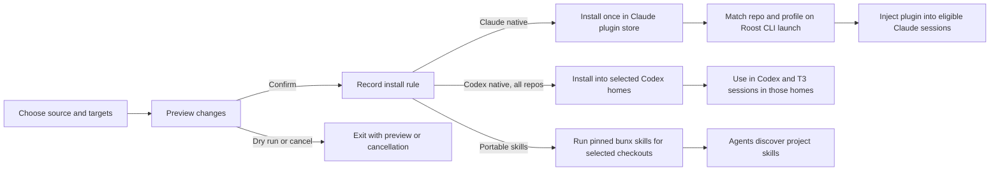
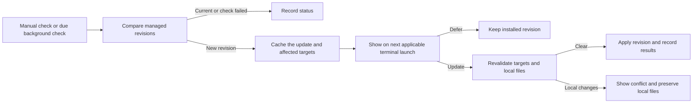

# Install plugins across Roost repositories and profiles

Add one Roost command to install a native plugin or a set of portable skills. Choose where it is available and which agents should receive it. Roost shows each target's install status, tells you when a managed update is available, and applies that update on request.

## Command and scope

Extend the existing `roost plugin` command group. Keep `plugin add --set`, `plugin list`, `plugin update` and other existing commands compatible. The commands below are proposed.

### Examples

```sh
# Install native packages for all compatible Roost profiles.
roost plugin install mattpocock/skills --all-repos --all-profiles

# Install selected skills into two repositories for both coding agents.
roost plugin install mattpocock/skills --skills --skill grill-me \
  --repo ~/Code/roost --repo ~/Code/another-repo --agent claude --agent codex

# Install the native Claude plugin for one repo and one profile.
roost plugin install mattpocock/skills --agent claude --here --profile claude:work
```

### Command reference

| Command | What it does |
| --- | --- |
| `roost plugin install SOURCE` | Resolves the source, previews the agents, repos, and profiles it will affect, and records the install rule. Native plugins are the default. `--skills --skill NAME` selects a portable skill from the source. Repeat `--skill`, `--agent`, `--repo`, or `--profile` to select multiple targets where supported. |
| `roost project add PATH` | Registers a Git checkout for selection in future installs. Registering a checkout adds it to the pending list for any applicable all-repo skills rule. The checkout receives files when you sync. |
| `roost project list` | Lists registered repos and their known checkout paths. Use these paths with `--repo`. |
| `roost plugin list --managed` | Shows Roost install rules, scope, installed revisions, cached update status, and targets that are pending, failed, or in conflict. Use this to see what the last install reached. |
| `roost plugin check` | Looks for newer revisions of managed installs and saves the results for later prompts. Leaves the installed versions in place. |
| `roost plugin update --managed [SOURCE]` | Applies available revisions to the targets already recorded for the source. Omit `SOURCE` to review available updates across managed installs. When an artifact is shared, the prompt names every rule or set that will receive the new revision. |
| `roost plugin sync` | Installs the currently selected revision into pending targets and retries failed installs, including newly registered checkouts and new Codex profiles covered by an all-profiles rule. |
| `roost plugin uninstall SOURCE` | Shows the rules and artifacts associated with the source, then removes the selected rules and their verified, unreferenced managed artifacts. Shared installs stay available to other rules or sets that still reference them. |

### Scope rules

- Repository scope is the current Git repo, an explicit list of repos, or all repos. For native plugins, all repos is a standing policy. For project-local skills, it covers the explicit Roost project inventory, including the current repo when selected. Future registrations enter the pending list and get installed on `plugin sync`. A Roost profile selection can help populate the picker, but it does not count as consent to write to that repo. A plain folder, malformed Git metadata, or an unavailable checkout produces a clear per-target result.
- Profile scope for native plugins is all compatible Roost profiles or an explicit list using the existing `claude:NAME` and `codex:NAME` selectors. All profiles includes compatible profiles added later. New Claude profiles are covered at launch. New Codex homes show pending until synced. Skills written into a repo are available to every profile of the selected agents that uses that checkout. The CLI rejects profile filters for this install mode.
- With a terminal, show a selection and confirmation screen that lists the resolved sources, repos, agents, and directories that will change. Reuse Roost's picker conventions. For automation require explicit targets and `--yes` for bulk repo writes, support `--dry-run`, and return the existing JSON envelope with per-target results.
- Resolve provider marketplace sources and plugin IDs explicitly. For the first release accept provider-qualified IDs and marketplace sources, plus a documented shorthand for catalogs that expose one unambiguous plugin per requested agent. Resolve `mattpocock/skills` against the provider catalogs as the acceptance example. Show the skills option when native install is unavailable and the source offers compatible skills. Require the user to select it, since a skills install only delivers skills and writes into project directories. Avoid installing the same package both ways for the same agent and checkout. [Matt Pocock's install instructions](https://github.com/mattpocock/skills#installation-30-second-setup)

## How the flows work

### Install and activate



### Check and apply an update



## Provider support

| Target | Install and activation |
| --- | --- |
| Claude native, all or selected repos and profiles | Install once through the existing account-less Claude plugin store. At CLI launch, union the matching install rules with existing subscribed set items, then use the existing dependency and collision checks and `CLAUDE_CODE_PLUGIN_DIRS` injection. Owned and registered upstream profiles can receive these rules. Default aliases keep their pass-through behavior. |
| Codex native, all repos and all or selected profiles | Run Codex's marketplace and plugin commands against marker-verified Roost-owned `CODEX_HOME` directories. This also covers T3 providers configured to use those homes. Registry-local installs that need account authentication report the provider result and keep credentials in that home. |
| Codex native, selected repos | First release offers the repo-local skills workflow. A trusted repo's `.codex/config.toml` controlled a local marketplace plugin in an isolated Codex 0.169.0 test. The CLI `-c` flag left the disabled plugin's skill visible. Native repo scoping can follow once Roost can install with the home default disabled and preserve existing trust and config across worktrees. |
| Portable skills, all or selected repos | Run a pinned `bunx --bun skills` CLI with explicit skill names and `-a claude-code codex` as selected. Use the repo's worktree root for project paths and show `.agents/skills/`, any Claude skill links, and `skills-lock.json` in the preview. A repository rule can cover every worktree for Roost launch matching. Repo-local skill files need an install in each checkout unless they already arrive through Git. Sync reports pending worktrees and deduplicates repeated paths in the same checkout. |

Claude Desktop launches keep existing profile set behavior. The project picker owns repo targeting for CLI launches, where Roost can resolve the active checkout. Codex-native installs use the home being configured, so their scope includes direct Codex and T3 sessions in that home. [Codex plugin and marketplace docs](https://developers.openai.com/plugins/build/plugins) · [skills agent directories](https://github.com/vercel-labs/skills/blob/main/docs/agents.md)

## Implementation order

1. **Record targets and desired state.** Reuse `select::project_key` for the Git common directory and expose the checkout root alongside it. Use the existing profile IDs for explicit filters so a reused name cannot inherit a stale rule. Add a versioned side file through `store::side` for the project inventory, install rules, installed revisions, and managed target outcomes. Old roots with a missing file read as empty. Write the rule before doing provider work so an interrupted install can be resumed. Resolve and revalidate target identity when applying results. Keep root locks out of child processes, network checks, and prompts, and serialize writes per store, Codex home, or skill checkout with separate locks.
2. **Wire native adapters.** Factor existing Claude store install and marketplace operations out of `plugins.rs` where needed. Match repo rules in the shared Claude CLI launch path in `select.rs` so bare `roost`, named `run`, and generated launchers agree. Share a store artifact across rules and existing sets. For Codex, reuse `store::codex` validation and the auth environment handling in `launch.rs`. Use `codex plugin add --json` and `plugin list --json` from a neutral directory, and verify the installed ID and version. An already present native install is reported as pre-existing. An explicit Roost uninstall removes a managed native install only when its last Roost reference is gone and Roost can still verify that install.
3. **Wire project skills.** Validate the pinned skills CLI on macOS and Linux. Run in a verified checkout with the requested agents, or stage and apply the CLI output if the installer would overwrite existing skill files. Record installed skill names, source/ref, installed content hash, and owned paths so reruns converge, and update or removal preserves local edits and unrelated skills. Preserve the target agent list and lock entries on update. Report a conflict when a pre-existing skill would be replaced. Use per-target status to resume failed installs without repeating successful ones. [skills CLI commands](https://github.com/vercel-labs/skills/blob/main/docs/commands.md)
4. **Check and prompt for updates.** `roost plugin check` checks only managed installs and caches the installed versus available version or content hash. Use read-only provider metadata where it is reliable. Codex marketplace upgrade refreshes a snapshot, so keep that mutation in the update path. For skills, validate the pinned `skills check` contract in an isolated fixture. Version 1.9.0 emitted text for `check --json` and included global installs when called outside a project. If it cannot provide a reliable project-only result, resolve and compare skill content through a temporary checkout and a staged `skills add`. Distinguish an upstream update, local edits, and a failed check. A daily, bounded background check can refresh the cache after a relevant Roost CLI launch, reusing the existing timestamp-claim pattern. Prompt on the next applicable terminal launch with the affected targets and the option to update or defer. Noninteractive commands surface cached status without prompting. Applying a revision uses the same scope and validates it again before writing. Existing opt-in Claude store auto-update and provider-native updates need to be reflected in status, since those can already change an installed version.
5. **Verify and document.** Extend the fake-agent integration tests in `tests/plugins.rs` and `tests/codex.rs`. Add a fake `bunx` and fixture Git repos with linked worktrees. Cover two repos and profiles per provider, eligibility across entry points, no leakage for subsets, overlapping rules, recovery after a partial write, collisions, missing tooling, timeouts, update/defer, and stable JSON. Use disposable real-tool smoke tests for local Codex and Claude marketplaces and the pinned skills CLI. Verify that a newly launched agent sees the intended plugin or skill in the included repo and that an excluded launch cannot see it. Run the repo's format check, tests, and clippy. Add README examples and record provider limits beside ADR 0001.

## Release checks

- One install command handles all compatible native profiles with `mattpocock/skills`. The Claude store has one copy even when multiple profiles are selected.
- A selected-repo install delivers portable skills to both agents on the named checkouts. Other repos keep their current skill directories and lock files.
- A changed upstream skill produces one actionable update prompt per revision and target scope. Deferring preserves the installed revision, and accepting updates only those targets. Local edits remain visible as conflicts.
- A failed target shows a reason and can be retried without rerunning successful targets. Existing shared sets and profile selections continue to work.
